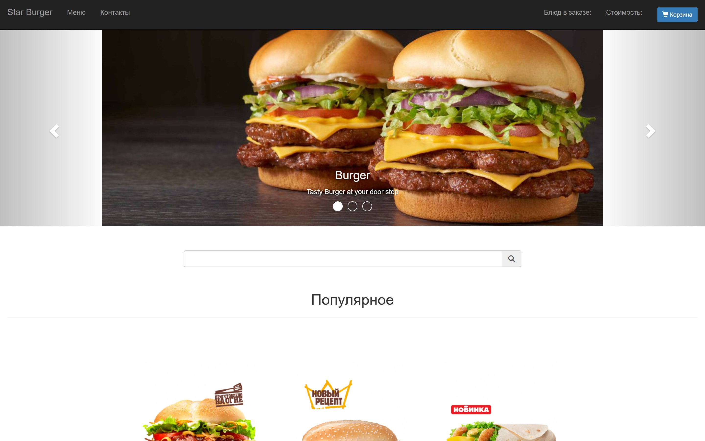
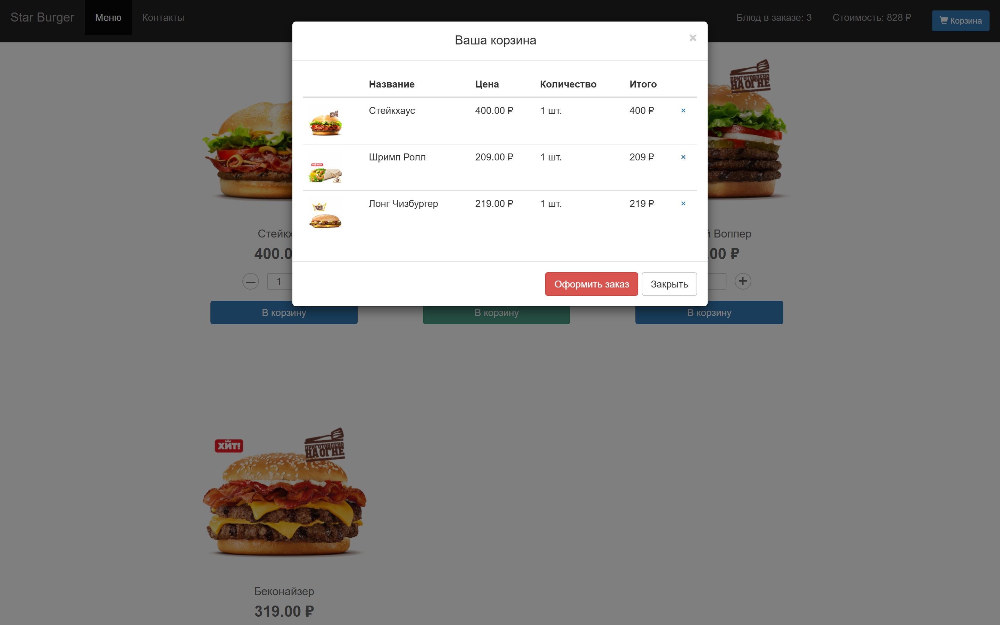
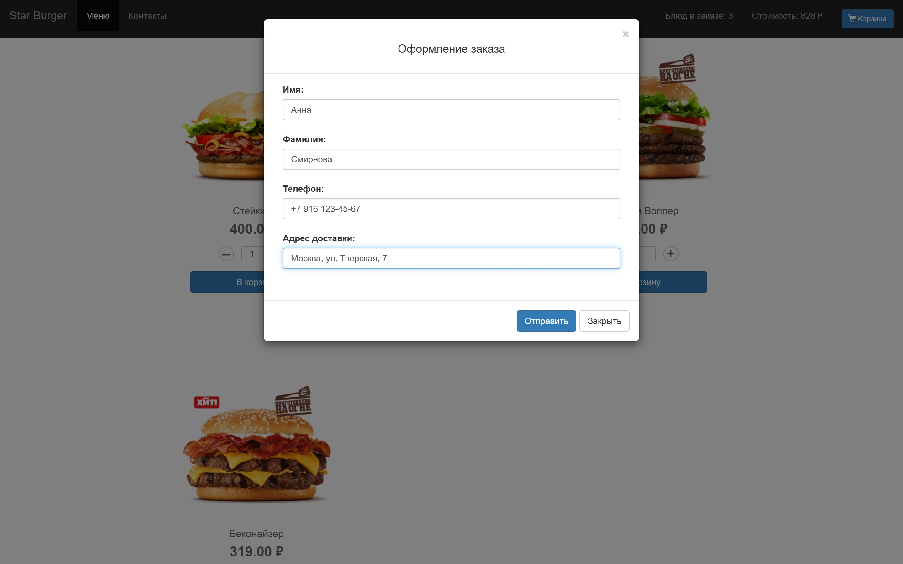
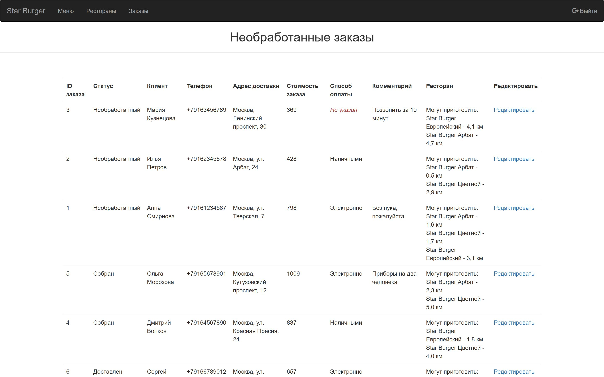
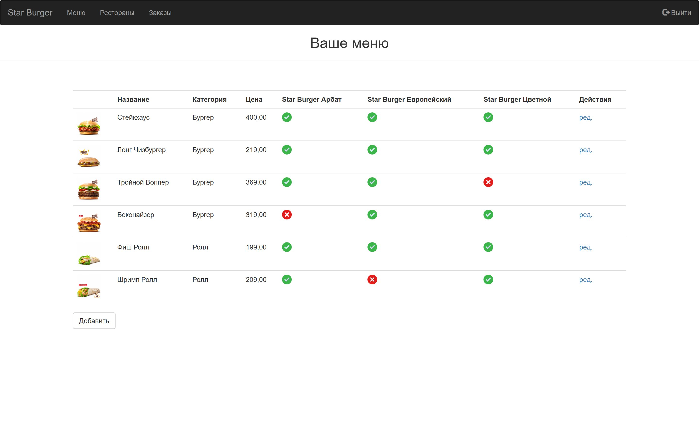
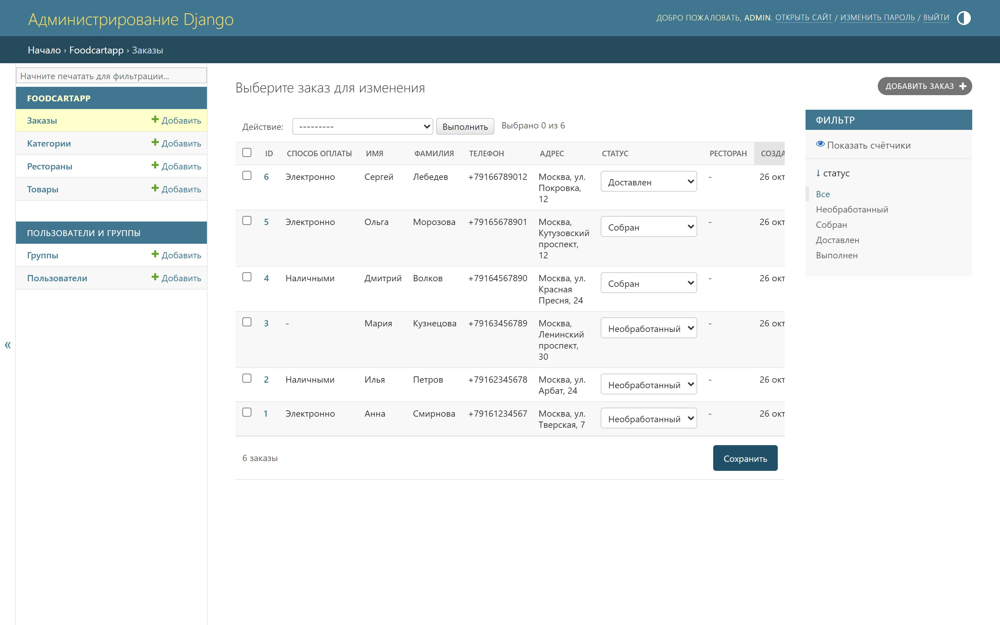
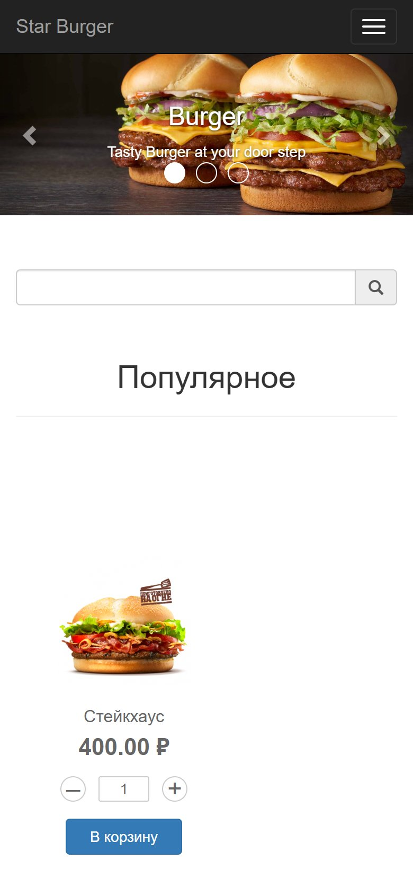
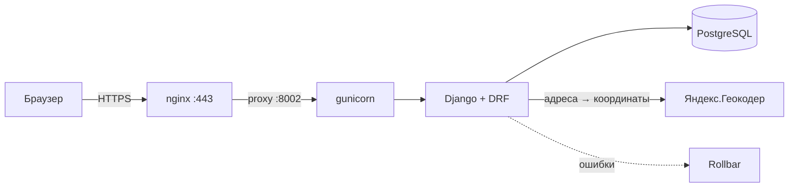

# Star Burger

[](https://github.com/skislyakow/star-burger/actions/workflows/ci.yml)




- **Живой сайт:** <https://star-burger.kislyakov.pro>
- **Демо-панель менеджера:** <https://star-burger.kislyakov.pro/manager/login/> — логин `demo`, пароль `demo-star-burger`

Сайт сети бургерных с доставкой: меню с корзиной, оформление заказа без
регистрации, панель менеджера для обработки заказов и админка. Проект вырос из
учебного задания [Devman](https://dvmn.org/) и доведён до состояния боевого
сервиса: PostgreSQL, CI, мониторинг ошибок, деплой за nginx и systemd.

## Что умеет

**Витрина**
- меню по категориям, поиск по названию, быстрый просмотр блюда;
- корзина с количеством и суммой, оформление заказа без регистрации;
- статус заказа по ссылке после оформления: состав, сумма, этапы доставки;
  ссылка подписана и действует 30 дней;
- цена фиксируется на сервере в момент заказа — клиент не может её подменить.

**Панель менеджера** (`/manager/`)
- список необработанных заказов с составом, суммой, способом оплаты и
  комментарием;
- подсказка, какие рестораны могут приготовить заказ и как далеко они находятся:
  расстояние считается по координатам из Яндекс.Геокодера и кэшируется в базе;
- матрица доступности блюд по ресторанам;
- список ресторанов и переход в админку для редактирования.

**Админка** (`/admin/`)
- товары с превью картинок, категории, рестораны и меню;
- заказы с инлайнами позиций, сменой статуса и привязкой ресторана.

**Инфраструктура**
- интеграция с Rollbar (middleware включается только при заданном токене);
- управление зависимостями через `uv` (lock-файл в репозитории);
- pre-commit: `ruff`, `djlint`, `mypy` + `django-stubs`;
- тесты на `pytest-django` (backend) и `vitest` (корзина и форматирование цен);
- GitHub Actions: линтеры, тесты, `manage.py check` с `DEBUG=True/False`,
  проверка неприменённых миграций;
- прод-периметр: HTTPS-редирект, HSTS, secure-cookies, throttling и `/healthz/`;
- деплой: `git pull` → `uv sync` → сборка фронта → `collectstatic` → `migrate` →
  рестарт systemd-сервиса (см. [AGENTS.md](AGENTS.md)).

## Скриншоты

| Корзина | Оформление заказа |
| --- | --- |
|  |  |

| Панель менеджера: заказы | Панель менеджера: меню |
| --- | --- |
|  |  |

| Админка: заказы | Мобильная витрина |
| --- | --- |
|  |  |

## Стек

| Слой | Технологии |
| --- | --- |
| Backend | Python 3.12+, Django 5.2, Django REST Framework, `phonenumber_field` |
| БД | PostgreSQL 16 (в dev можно SQLite) |
| Frontend | React 17, Bootstrap 3, Parcel 2, Vitest |
| Геоданные | Яндекс.Геокодер + `geopy` |
| Мониторинг | Rollbar |
| Качество | `ruff`, `djlint`, `mypy`, `pre-commit`, `pytest-django`, `vitest`, GitHub Actions |
| Прод | gunicorn, nginx, systemd, certbot |

## Как устроено



```
star_burger/        настройки, корневые URL, WSGI
foodcartapp/        каталог, модели заказа, публичное API, статус заказа, админка
places/             кэш координат и клиент Яндекс.Геокодера
restaurateur/       панель менеджера: вход, заказы, меню, рестораны
templates/          HTML-оболочка витрины
bundles-src/        исходники фронтенда (React + Parcel)
docs/screenshots/   скриншоты для README
```

Публичное API:

| Метод | Адрес | Назначение |
| --- | --- | --- |
| `GET` | `/api/products/` | доступные товары с категориями и картинками |
| `GET` | `/api/banners/` | баннеры на главной |
| `POST` | `/api/order/` | создание заказа: имя, фамилия, телефон, адрес, позиции (не чаще 30 раз в час с одного IP) |
| `GET` | `/order/<token>/` | статус заказа по подписанной ссылке из ответа `POST /api/order/` |

Ключевые решения:

- **Снимок цены.** `OrderItem.price` записывается при создании заказа, поэтому
  изменение прайса не переписывает историю, а клиент не присылает цену сам.
- **Сумма заказа** считается на стороне БД (`Order.objects.with_total_cost()`),
  а не в шаблоне.
- **Доступность блюд** — отдельная таблица `RestaurantMenuItem`; витрина
  показывает блюдо, если его готовит хотя бы один ресторан.
- **Статус заказа.** `/order/<token>/` открывается без входа: в токене лежит
  id заказа, подписанный `SECRET_KEY`, поэтому перебрать чужие заказы нельзя,
  а срок жизни ссылки — 30 дней. На странице только состав, сумма, адрес и
  этапы доставки; телефон маскируется, страница закрыта от индексации.
- **Геокодер** кэширует координаты в таблице `Place`: удачные ответы живут
  30 дней, неудачные — сутки. Просроченные координаты запрашиваются заново, а
  если Яндекс недоступен, остаются прежние — расстояние лучше, чем ничего.
- **Периметр**: HTTPS-редирект, HSTS и secure-cookies включаются переменной
  `SECURE_SSL_REDIRECT=True`; за nginx Django читает `X-Forwarded-Proto`.
- **Мониторинг**: `/healthz/` отдаёт 200, только если процесс жив и база
  отвечает на `SELECT 1`.
- **Антиспам**: публичный `/api/order/` ограничен по IP через DRF throttling;
  в проде Browsable API выключен, остаётся только JSON.

## Быстрый старт

Нужны Python 3.12+, [uv](https://docs.astral.sh/uv/), Node.js 22+ и Docker
(для PostgreSQL; можно обойтись SQLite).

```powershell
git clone https://github.com/skislyakow/star-burger.git
cd star-burger
uv sync
npm ci

# PostgreSQL 16
docker run -d --name starburger-pg `
  -e POSTGRES_USER=starburger `
  -e POSTGRES_PASSWORD=starburger `
  -e POSTGRES_DB=starburger `
  -p 5432:5432 postgres:16
```

Скопируйте `.env.example` в `.env` и подставьте свой `SECRET_KEY`:

```powershell
Copy-Item .env.example .env
uv run python -c "from django.core.management.utils import get_random_secret_key as k; print(k())"
```

Дальше — схема, демо-данные и сборка фронта:

```powershell
uv run python manage.py migrate
uv run python manage.py seed_demo --orders 6
npm run build
uv run python manage.py runserver
```

Сайт: <http://127.0.0.1:8000>, панель менеджера: `/manager/login/`
(`demo` / `demo-star-burger`), админка: `/admin/` (суперпользователь создаётся
через `uv run python manage.py createsuperuser`).

`seed_demo` идемпотентен: создаёт три ресторана, меню и демо-менеджера, а
`--orders N` добавляет демо-заказы, только если база пустая. Существующие
товары с настоящими фотографиями команда не трогает; для новых рисует
картинки-заглушки.

Во время разработки фронта вместо `npm run build` удобнее держать `npm run watch`:

```powershell
npm run watch
```

Фронтенд разложен по слоям: `bundles-src/api.js` — запросы к API и тексты
ошибок, `bundles-src/cart.js` — чистые функции корзины (без React),
`bundles-src/format.js` — форматирование цен, `App.js` — состояние и разметка.

## Переменные окружения

| Переменная | Обязательна | Назначение |
| --- | --- | --- |
| `SECRET_KEY` | да | ключ Django |
| `DEBUG` | нет | `True` по умолчанию; на проде — `False` |
| `ALLOWED_HOSTS` | на проде | список хостов через запятую |
| `DATABASE_URL` | нет | без неё используется SQLite |
| `YANDEX_GEOCODER_API_KEY` | нет | ключ Геокодера; без него не считаются расстояния |
| `ROLLBAR_TOKEN` | нет | включает отправку ошибок в Rollbar |
| `ROLLBAR_ENVIRONMENT` | нет | окружение в Rollbar |
| `SECURE_SSL_REDIRECT` | нет | `True` на проде: HTTPS-редирект, secure-cookies, HSTS |
| `DEMO_MANAGER_PASSWORD` | нет | пароль демо-менеджера для `seed_demo` |

Полный список с комментариями — в [.env.example](.env.example).

## Команды

| Команда | Что делает |
| --- | --- |
| `uv run python manage.py runserver` | dev-сервер |
| `uv run python manage.py migrate` | применяет миграции |
| `uv run python manage.py seed_demo --orders 6` | демо-данные и демо-менеджер |
| `uv run python manage.py check --deploy` | аудит прод-настроек безопасности |
| `uv run pre-commit run --all-files` | линтеры, формат и типы |
| `uv run pytest` | тесты бэкенда (pytest-django) |
| `npm test` | тесты фронтенда (vitest) |
| `npm run build` | сборка фронта в `bundles/` |

## Качество кода

- `ruff` — линт и формат Python (длина строки 79);
- `djlint` — форматирование Django-шаблонов;
- `mypy` + `django-stubs` — проверка типов;
- `pytest-django` — тесты бэкенда, `vitest` — тесты фронтенда;
- CI прогоняет всё это на каждый push и pull request, плюс `manage.py check`
  с `DEBUG=True` и `DEBUG=False`, `makemigrations --check`, `npm test` и
  `npm run build`.

Тесты (`tests/`, 72 штуки) проверяют то, что раньше держалось на честном слове:

- `test_order_placement.py` — снимок цены, схлопывание повторяющихся позиций,
  отказ для недоступного товара и отсутствие «полузаказа» при ошибке;
- `test_fulfillment.py` — пересечение меню ресторанов, расстояния, сортировка
  и один вызов геокодера на всю страницу;
- `test_status_transitions.py` — даты звонка и доставки, авто-статус «Собран»
  при назначении ресторана в админке;
- `test_manager_access.py` — доступ к доске менеджера только для staff и
  сборка таблицы из данных заказа;
- `test_order_tracking.py` — подписанные ссылки и их срок жизни, страница
  статуса, маскировка телефона, 404 для битой ссылки и ссылка из API;
- `test_geocoder.py` — кэш `Place`, TTL и негативный кэш, разбор ответа Яндекса
  и молчаливый отказ без падения страницы;
- `test_healthz.py` — `/healthz/` отвечает 200 при живой базе и 503 без неё.

Фронтенд-тесты лежат рядом с кодом (`bundles-src/cart.test.js`) и проверяют
чистые функции корзины: сложение количеств, удаление по id (регрессия на
`splice(-1)`), подсчёт штук и суммы, формат цены.

`pytest-django` создаёт отдельную тестовую базу. Если локальный PostgreSQL не
запущен, тесты можно прогнать на SQLite:

```powershell
$env:DATABASE_URL="sqlite:///C:/code/star-burger/db.sqlite3"; uv run pytest
```

Что дальше: push/SMS-уведомления о смене статуса (сейчас клиент сам открывает
ссылку) и общий лимит заказов через Redis (сейчас счётчик у каждого воркера
свой).

## Деплой

Прод живёт на Ubuntu 24.04: nginx → gunicorn `127.0.0.1:8002` под systemd,
PostgreSQL на том же хосте, HTTPS через certbot. Полная инструкция по
развёртыванию, обновлению и диагностике — в [AGENTS.md](AGENTS.md).

## О проекте

Стартовый код и вёрстка — из курса Devman «Основы веб-разработки». Дальше
проект переехал на PostgreSQL, получил управление зависимостями через `uv`,
pre-commit и CI, мониторинг ошибок, кэш геокодера, нормальный деплой и
демо-данные для быстрого запуска.

## Лицензия

[MIT](LICENSE)
